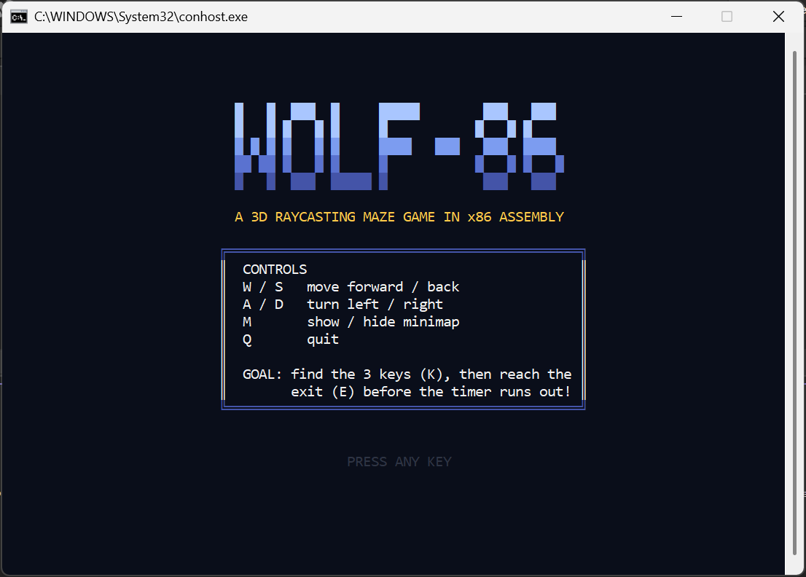
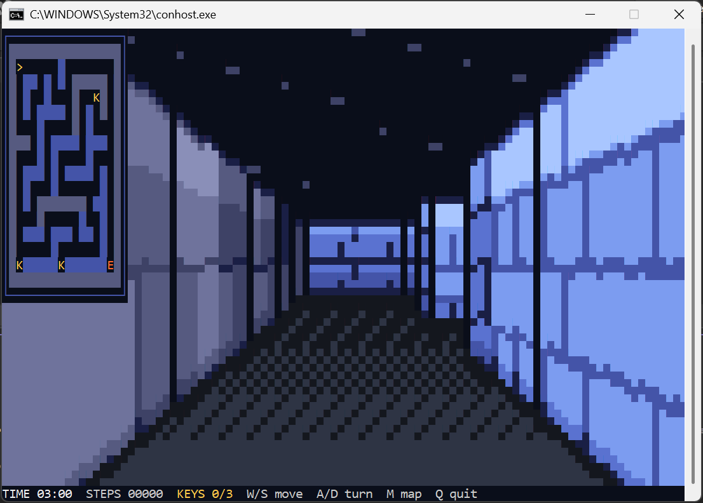
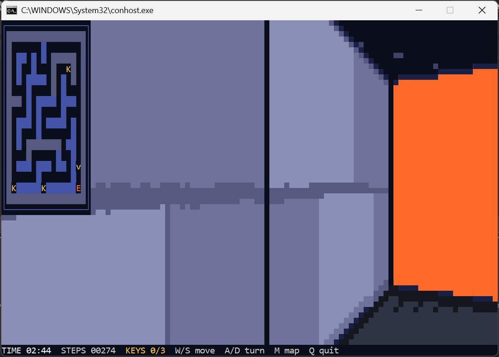
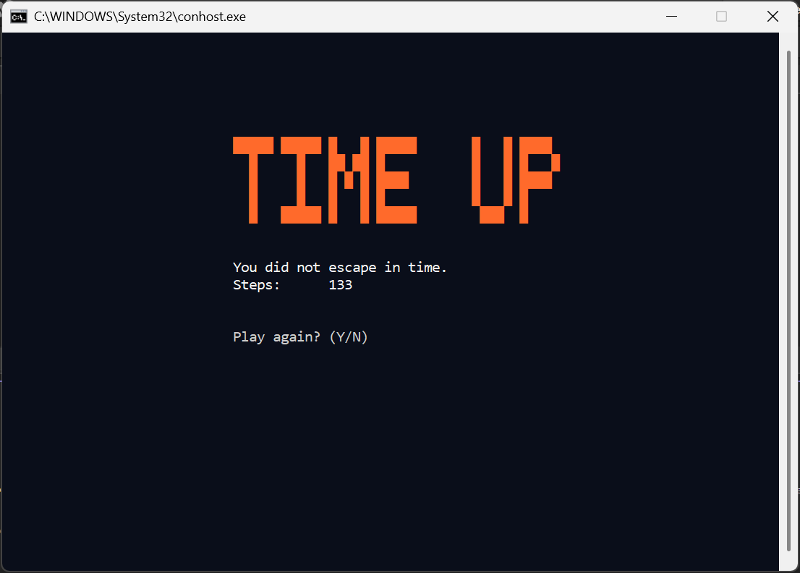

# WOLF-86

A first-person 3D raycasting maze game written in 32-bit x86 assembly (MASM + Irvine32) for the Windows console.



## Features

- **Raycasting 3D view** – one ray per pixel column, DDA grid stepping, camera-plane rays (no fisheye).
- **Half-block rendering** – every console cell shows two pixels (`▀` with separate foreground/background colours), giving a 100 × 60 pixel view drawn with a single `WriteConsoleOutput` call.
- **Two wall materials** – blue brick (`#`) and grey-violet slate stone (`%`), textured, shaded by distance, darker on one side, with crisp edge lines between walls.
- **Custom palette** – a blue ↔ orange 16-colour theme set with `SetConsoleScreenBufferInfoEx`; the original palette is restored on exit, with a standard-colour fallback.
- **Keys and a locked door** – collect 3 keys, then escape through the blinking exit before the 180-second timer runs out.
- **Minimap, HUD and messages** – bordered minimap with a direction arrow, timer (turns red under 20 s), step and key counters, "KEY FOUND" / "DOOR LOCKED" messages.
- **Title, win and lose screens** – block-letter logo and banners, play again (Y/N).
- **Integer maths only** – Q8 fixed point (value × 256), 360-entry sine table, no FPU or SSE.

| Corridor (3D view + minimap) | Exit door (blinking) |
|---|---|
|  |  |
| **Time up** | |
|  | |

## Controls

| Key | Action |
|-----|--------|
| `W` / `S` | Move forward / backward (hold) |
| `A` / `D` | Turn left / right (hold; works together with W/S) |
| `M` | Show / hide the minimap |
| `Q` | Quit (in game, title, win and lose screens) |
| `Y` / `N` | Play again or not (after a game) |

**Goal:** find the 3 keys (`K`), then walk into the exit door (`E`) before the timer runs out.

## How to run

Requirements: Windows, **Visual Studio 2022** with the C++ workload (MASM), and the **Irvine32** library installed in `C:\Irvine`.

1. Open `COAL Project.slnx` (or `COAL Project.vcxproj`) in Visual Studio 2022.
2. The project is already configured. For a new project, set:
   - *Build Dependencies → Build Customizations*: tick **masm**
   - *Microsoft Macro Assembler → General → Include Paths*: `C:\Irvine`
   - *Linker → General → Additional Library Directories*: `C:\Irvine`
   - *Linker → Input → Additional Dependencies*: `Irvine32.lib;kernel32.lib;user32.lib`
   - *Linker → System → SubSystem*: Console
3. Select **Debug** and **x86**, then press **F5**.

Command line (Developer PowerShell):

```
msbuild "COAL Project.slnx" /p:Configuration=Debug /p:Platform=x86
"Debug\COAL Project.exe"
```

The game resizes its console window to 100 × 31 characters. In the classic console host the palette is set with `SetConsoleScreenBufferInfoEx`; in Windows Terminal (also used by F5 in Visual Studio) it is set with VT escape sequences (OSC 4) and reset on exit.

## How it works

- **Raycasting:** for every pixel column a ray `dir + plane · cameraX` is cast from the player into the 16 × 16 map, with `dir = (cos, sin)` and `plane = (−sin, cos) · tan 30°`.
- **DDA:** the ray jumps from grid line to grid line (`sideDist` / `deltaDist` per axis) until it enters a wall, door or key cell. With camera-plane rays the DDA distance is already the perpendicular distance, so walls are straight.
- **Fixed point:** all positions, directions and distances are Q8 integers; the `FIXMUL` macro (IMUL + SAR 8) multiplies two Q8 numbers.
- **Wall slice:** height = `PIX_H · 256 / distance`, centred on the horizon. Texture coordinates (`wallX` along the wall, `texY` down the slice) select brick, mortar, stone or seam colours; the distance picks one of four shades.
- **Half-block rendering:** the view is drawn into a pixel buffer (one colour role per pixel). Each console cell combines two pixels: character 223 (upper half block), top pixel = foreground colour, bottom pixel = background colour. The composed `CHAR_INFO` buffer, together with the HUD row and the minimap overlay, is written with one `WriteConsoleOutput` call.
- **Palette:** colours are *roles* (sky, brick 0–3, stone 0–3, floor, door, gold …). A role table maps them either to the custom palette slots or to standard colours if the palette cannot be changed.
- **Collision:** the player is a square box (radius 0.31 cell); all four corners are tested, X and Y separately, so the player slides along walls and never gets too close to a corner. In corridors the player is gently nudged towards the centre, and turning accelerates from 2° to 5° per frame.

## Team

| Name | Roll number | Role |
|------|-------------|------|
| Anas Furqan | 25K-0577 | Team leader |
| Ahsan Abbasi | 25K-0961 | Member |
| Muhammad Zohaan | 25K-0726 | Member |

EL-2003 Computer Organization and Assembly Language Lab, Fall 2026.
